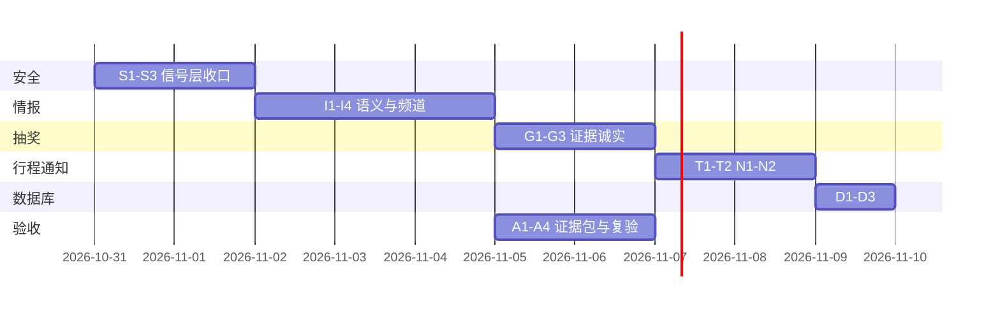

# FlightHunter V1.0 冲刺收尾计划

- **文档目的：** 给 GPT / Codex 审阅的实施计划（不是验收报告）  
- **当前基线：** `9c6d83c`（`develop`，已 push GitHub）  
- **产品定位：** 本地优先的个人国际旅行机会助手（情报 + 免费机票抽奖线索 + 行程福利）  
- **V1 关门原则（已确认）：**  
  - 不要求实时报价 API  
  - 不自动购票 / 付款 / 未授权报名  
  - 不绕过 robots / CAPTCHA / 站点条款  
  - 不宣称完整 V1.0 / 公网安全认证，直到独立复验  
  - 不重置 72h 观测、不动正式库 / Worker  

---

## 1. 当前状态（诚实基线）

### 1.1 已具备（可复现）

| 能力 | 证据 |
|---|---|
| P1 四频道情报（我的出发地 / 全国 / 港澳 / 全球错价） | UI + `/api/v1/fare/intel` |
| 真实来源只读抓取（FlyNext 等） | HTTPS 200，列表解析 4 条 |
| 安全抓取层 | 每跳 URL/DNS 校验、robots fail-closed、流式限额、连接期 IP 绑定（`PublicAddressBackend`） |
| 多目的地不串价、MOP/HKD、发布标签日期 | 单测 + 自查脚本 |
| P2 抽奖候选 / 合成资格三态 / 不虚构 eligible | 单测 |
| P3 行程确认后才扫、确认恢复订阅 | 单测 |
| 通知事件键、失败限次、pwsh toast | 持久表 `notification_deliveries` |
| 迁移检查（outdated / no_version / in_sync） | 隔离演练 |
| 单元测试 | **279 passed**（ruff 改动文件通过） |

### 1.2 明确未完成（不能当 V1）

| 项 | 状态 |
|---|---|
| 104 项需求清单逐条验收 | **NOT_TESTED** |
| 72h 连续运行证据 | **NOT_TESTED** |
| 真实桌面 toast / 进程崩溃精确一次 | **NOT_TESTED** |
| 浏览器子资源 / 重定向绑安全 backend | **partial** |
| HTTPX 私有 `_network_backend` 升级兼容 | **partial** |
| 抽奖「中国内地出境」正向核心推荐闭环 | **partial** |
| 跨站改写事件级合并 | **保守 partial**（有意） |
| 公网部署 / 渗透 / CSP | **不在 V1** |
| Codex 独立关单 | **0 次**（待复验） |

---

## 2. 冲刺目标（本计划要交付什么）

> **目标：把「个人日常可靠使用」所需的闭环补齐，并给出可被 Codex 独立复验的证据包。**  
> **不以** 公网 SaaS、实时报价、100% 来源覆盖为关门条件。

成功标准（一句话）：

1. 未确认/demo 行程永不正式扫描；确认后可恢复监控（含开关边界）。  
2. 任何对外请求不经安全层不可达生产路径；私网/重绑定/超限/robots 均 fail-closed。  
3. 情报价格/币种/日期/出发地在标注样本上不串、不假、不冒充实时。  
4. 通知：成功不重复、失败有上限、状态跨进程可查。  
5. 数据库：旧库不被静默改写；迁移可演练可回滚说明齐全。  
6. 有**可重复执行**的验收脚本 + 真实日志，104 项中未测项诚实标注。

---

## 3. 工作包（建议执行顺序）

### P0 · 安全边界收口（1–2 天）

| ID | 任务 | 验收 |
|---|---|---|
| S1 | 浏览器/entry 自动化路径接入 `PublicAddressBackend` 或明确只读 + 子资源禁令 | 调用图审计：无裸 `httpx.get(follow_redirects=True)` |
| S2 | `PublicAddressBackend` 集成测试：MockTransport + 真实 HTTPS 可选；httpx 升级破坏性检测 | CI 挂接失败即红 |
| S3 | 依赖锁定：`httpcore` 范围 + 升级 checklist 入 `TECH_DEBT.md` | 文档 + `uv lock --check` |

**不做：** 全站 CSP、渗透报告。

### P1 · 情报语义与四频道（2–3 天）

| ID | 任务 | 验收 |
|---|---|---|
| I1 | 标注样本集 ≥30 条（真实 FlyNext 列表 + 合成负例）：出发/目的/金额/币种/发布/旅行 | 样本脚本一键跑，输出误命中/漏报 |
| I2 | 多价文章 UI：显示「多价/未知」+ 原文链接，不静默空价 | 人工点验 + API 字段 |
| I3 | 全球错价频道不带默认偏好；全国不并入港澳（回归） | API 测试 + 浏览器截屏 |
| I4 | feedback 筛选 / 目的地 / 类别 / travel 日期 端到端 | API + UI 联测 |

**不做：** 新来源大批量接入。

### P2 · 抽奖证据诚实（1–2 天）

| ID | 任务 | 验收 |
|---|---|---|
| G1 | `core_recommend` 正向仅「官方直链 + 内地出境原文证据 + 无排除/国内语义 + 人工/自动核实通过」 | 三态测试：正例/排除/国内/未知 |
| G2 | 页面展示：candidate / pending / verified 分栏，非 verified 不标「真实」 | 模板断言 |
| G3 | 合成资格：年龄/国籍/居住缺失 → unknown（已有）；补官方年龄字段模型（可选） | 单测 |

**不做：** 自动报名、真实提交表单。

### P3 · 行程与通知可靠性（1–2 天）

| ID | 任务 | 验收 |
|---|---|---|
| T1 | 状态机表：create/confirm/edit/cancel/complete/resume 单测全覆盖 | 现有 trips 测试扩展 |
| T2 | `auto_scan_on_trip_change=false` + `auto_attach_fare_watch=false` 组合矩阵 | 矩阵测试 |
| N1 | 通知并发/崩溃边界：进程在外送与事务间崩溃的语义写清楚（至少文档化） | 文档 + 可选集成测试 |
| N2 | `source_health` 区分 fetch/parse/existing/new/valuable | 指标字段 + 测试 |

### P4 · 数据库与运行（1 天）

| ID | 任务 | 验收 |
|---|---|---|
| D1 | CLI 启动接线 `ensure_migrations_or_warn`（与 Web 一致） | CLI smoke |
| D2 | 隔离库演练脚本固化：新库/无版本/落后/未知/升级/回滚说明 | `scripts/` 可重复 |
| D3 | Worker 单实例锁 + 心跳已有；补「观测起点不重置」检查 | 运行文档 |

**正式库操作：** 仅用户书面授权后执行；先备份。

### P5 · 验收与交接（1 天，与上述并行产出）

| ID | 任务 | 验收 |
|---|---|---|
| A1 | 104 项需求矩阵：逐条 PASS / FAIL / NOT_TESTED / BLOCKED + 证据链接 | `docs/REQUIREMENTS_MATRIX.md` 更新 |
| A2 | 72h 运行日志（真实 Worker，不重启观测） | 时间戳日志摘要 |
| A3 | 证据包：`git archive` + 测试输出 + 隔离命令 + 真实来源抽检记录 | 打包目录说明 |
| A4 | 交 GPT/Codex 复验任务书（沿 `review_exports/CODEX_CLIENT_INSTRUCTIONS.md` 模板） | 任务书定稿 |

---

## 4. 建议里程碑



- **每日：** 单测全绿才提交；不 push 违规内容（API Key / 私库 / 凭据）。  
- **合并策略：** 小 PR；Codex 改动继续 cherry-pick + 审 diff。  

---

## 5. 明确不在本冲刺

1. 实时报价供应商接入  
2. 公网多租户 / SaaS / 鉴权强化  
3. 自动购票、自动报名、自动付款  
4. 大规模新来源与付费 API  
5. 完整渗透 / CSP / 法律合规出证  
6. 重写架构（保持 FastAPI + SQLite + Worker）

---

## 6. 风险与对策

| 风险 | 对策 |
|---|---|
| HTTPX 内部 API 升级破坏安全传输 | 锁版本；集成测试红灯；`TECH_DEBT.md` |
| 浏览器路径仍是 SSRF 边角 | P0 只读 + 子资源禁令；否则标 BLOCKED |
| 标注样本不足导致误报率虚高 | I1 强制 30+ 样本；公开误命中率 |
| 72h 被人工重启污染 | 观测起点只记不重置；日志写 PID/启动时间 |
| 通知精确一次难以证明 | 文档化语义 + 失败上限；不假称 exactly-once |
| Codex/GPT 复验反复往返 | 一次证据包提交；差异项书面说明采纳/不采纳 |

---

## 7. 请 GPT / Codex 审阅的问题（请逐条给结论）

1. **范围：** P0–P5 是否覆盖「个人日常可靠使用」关门条件？有无缺失或过度？  
2. **顺序：** 是否应把 72h / 104 项矩阵更提前？  
3. **core_recommend 正向路径：** 仅「官方+原文证据+核实通过」是否足够保守？还要哪些负例？  
4. **PublicAddressBackend：** 使用 httpx 私有 `_network_backend` 是否可接受？替代方案？  
5. **通知语义：** 应追求 exactly-once 还是 at-most-once + 上限重试即可？  
6. **验收证据：** 104 项矩阵中 NOT_TESTED 占多少比例仍可接受为「V1 个人版」？  
7. **回归策略：** 合并 Codex worktree 改动是否需要再跑真实 FlyNext 全链路？  
8. **任何必须先于收尾的阻塞缺陷。**

---

## 8. 附录：现状命令速查

```powershell
# 全量单测
$env:PYTHONPATH='.'; .\.venv\Scripts\python.exe -B -m pytest tests/unit -q -p no:cacheprovider

# R 系列自查
.\.venv\Scripts\python.exe -B scripts\selfcheck_r_series.py

# 合并后隔离冒烟
.\.venv\Scripts\python.exe -B scripts\smoke_after_codex_merge.py

# 迁移演练（隔离，不碰正式库）
.\.venv\Scripts\python.exe -B scripts\isolated_migrate_drill.py

# 只读来源抽检（需外网，遵守 robots）
.\.venv\Scripts\python.exe -B -m app.cli source-health --config data\daily_usage\config.yaml
```

---

## 9. 一句话总结

> 用 5 个工作包把安全、语义、证据、可靠性和验收闭环，交付可复验证据包；**不做公网、不做实时报价、不自动交易**；达标后交 Codex/GPT 独立判定是否 V1 个人日常可用。
